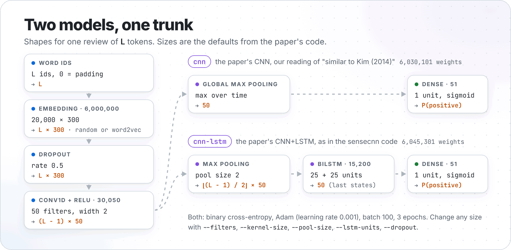

<p align="center">
  <picture>
    <source media="(prefers-color-scheme: dark)" srcset="docs/images/pipeline-dark.png">
    
  </picture>
</p>

<p align="center">
  <a href="https://github.com/NatLee/on-the-role-of-text-preprocessing-in-neural-network-architectures-for-imdb/actions/workflows/test.yml"></a>
  
  
  <a href="https://aclanthology.org/W18-5406/"></a>
  <a href="#how-to-cite"></a>
  <a href="LICENSE"></a>
</p>

# Text preprocessing in neural networks: the IMDb experiments

Does it matter whether you lowercase, lemmatize or group multiword expressions before you train a
neural text classifier? Camacho-Collados and Pilehvar measured it in
[*On the Role of Text Preprocessing in Neural Network Architectures*](https://aclanthology.org/W18-5406/)
(BlackboxNLP 2018). This repository is an **unofficial**, reproducible re-implementation of the IMDb part
of that study: pick one of the paper's four preprocessing variants and one of its two models, and
`preproc-imdb` trains it on the 25,000 training reviews and reports the accuracy on the 25,000 test
reviews. Every run leaves a folder with its settings, library versions, training history and every
prediction, so a number in a table can always be traced back and repeated.

It started in 2019 as a Python 3 port of the authors' [sensecnn](https://github.com/pilehvar/sensecnn)
code and was rewritten in 2026 (see [what changed](#differences-from-the-original-code)).

## Install

You need Python 3.11, 3.12 or 3.13 (TensorFlow 2.21 does not support other versions yet).

```bash
git clone https://github.com/NatLee/on-the-role-of-text-preprocessing-in-neural-network-architectures-for-imdb.git
cd on-the-role-of-text-preprocessing-in-neural-network-architectures-for-imdb
python -m pip install -e .
```

This installs the `preproc-imdb` command with the exact versions of Keras, TensorFlow and numpy that
produced the numbers below. Prefer containers? See [Docker](#docker).

## Quick start

The repository ships with the multiword variant of IMDb, so this works right after installing. It trains
the CNN+LSTM on 2,000 reviews per class, cut to their last 400 tokens, and tests it on 2,000 test
reviews per class:

```bash
preproc-imdb train --per-class 2000 --max-len 400
```

After a few start-up lines from TensorFlow (CPU features, no GPU found) you should see this, in about a
minute on a 32-core CPU. The seed is fixed, so running it again on the same setup gives the same
accuracy and loss:

```text
data: {"train_reviews": 4000, "validation_reviews": 0, "test_reviews": 4000, "max_len": 400, "vocabulary_ids": 20000, "test_token_coverage": 0.9477, "embedding_dim": 300, "embeddings_found": null}
run 1/1 (seed 1337): training cnn-lstm
Epoch 1/3
40/40 - 20s - 512ms/step - accuracy: 0.5625 - loss: 0.6894
Epoch 2/3
40/40 - 14s - 340ms/step - accuracy: 0.7763 - loss: 0.5136
Epoch 3/3
40/40 - 14s - 354ms/step - accuracy: 0.9080 - loss: 0.2518
run 1/1: test accuracy 0.8080
test accuracy: 0.8080 (runs: 0.8080)
results: runs/multiword-cnn-lstm-20261103-190556/results.json
```

Leave out `--per-class` and `--max-len` and you get the paper's setup: all 25,000 reviews of each
split, padded to the longest one, 3 epochs.

## Reproduce the paper

1. Download the other three preprocessing variants (96 MB) and the authors' word embeddings
   (four files, 7.1 GB in total). Every file is checked against a pinned SHA-256:

   ```bash
   preproc-imdb download --embeddings all
   ```

2. Paper's Table 2: the text and the embeddings are preprocessed the same way.

   ```bash
   for v in vanilla lowercased lemmatized multiword; do
     for m in cnn cnn-lstm; do
       preproc-imdb train -p $v -m $m --embeddings data/embeddings/umbc-$v.bin --runs 2
     done
   done
   ```

3. Paper's Table 3: vanilla text, embeddings trained on differently preprocessed text.

   ```bash
   for e in lowercased lemmatized multiword; do
     for m in cnn cnn-lstm; do
       preproc-imdb train -p vanilla -m $m --embeddings data/embeddings/umbc-$e.bin --runs 2
     done
   done
   ```

`--runs 2` trains two models with seeds 1337 and 1338 and reports the mean, like the paper's "average
accuracy of two different runs".

## Results

Accuracy (%) on the 25,000 IMDb test reviews. **Paper** is copied from the paper's Tables 2 and 3 (mean
of two runs; † marks a result significantly below the best one in its column). **This repo** is our own
run of the commands above on CPU (Docker, Python 3.12, TensorFlow 2.21, Keras 3.15): the mean of seeds
1337 and 1338 like the paper, except the cells marked ¹, which are one run (seed 1337) to save time.

Same preprocessing for the text and the embeddings (Table 2):

| Preprocessing | CNN, paper | CNN, this repo | CNN+LSTM, paper | CNN+LSTM, this repo |
|---|---:|---:|---:|---:|
| vanilla | 87.5 | 85.9 | 88.9 | 88.6 |
| lowercased | 84.2† | 86.4 | 88.3† | 89.3 |
| lemmatized | 86.8† | 86.5 | 87.7† | 88.9 |
| multiword | 87.9 | 86.1 | 88.9 | 89.1 |

Vanilla text, embeddings trained on differently preprocessed text (Table 3; the vanilla row is the same
experiment as in Table 2):

| Embeddings trained on | CNN, paper | CNN, this repo | CNN+LSTM, paper | CNN+LSTM, this repo |
|---|---:|---:|---:|---:|
| vanilla | 87.5† | 85.9 | 88.9 | 88.6 |
| lowercased | 85.4† | 86.6¹ | 88.0† | 88.9¹ |
| lemmatized | 86.8† | 85.9¹ | 86.6† | 89.0¹ |
| multiword | 88.1 | 86.3¹ | 87.3† | 89.0¹ |

What we take from it:

- **Same ballpark, same winner.** Every number lands between 85.9 and 89.3, and the CNN+LSTM beats the
  CNN in every row, as in the paper.
- **Our CNN is 1 to 2 points below the paper's** for vanilla and multiword. Its code was never published
  (see [Models](#models)), so part of the gap may be our reading of it.
- **The preprocessing ranking does not come back.** Across the four variants our results move by at most
  0.7 points, while the same setup with a different seed moved by up to 1.5 points (vanilla CNN+LSTM:
  87.8 and 89.3). With two seeds we can neither confirm nor rule out the paper's gaps, for example its
  84.2 for lowercased text with the CNN.
- **Fine-tuning hides missing vectors.** With vanilla text, the lowercased embeddings have vectors for
  only 13,265 of the 19,998 vocabulary words (capitalised words are missing) and the lemmatized ones for
  16,417, yet accuracy hardly changes, because the embeddings keep training.

Each run left a `results.json`; all 22 are in [`docs/results/`](docs/results/), with their settings,
versions, training history and timing. On 10 to 11 CPU cores one CNN run trained in 5 to 8 minutes and
one CNN+LSTM run in 13 to 19 minutes, three runs at a time.

## How it works

### Preprocessing variants

A variant is a folder of text files, one review per line, tokens separated by spaces:
`data/IMDb/<variant>/<train|test>/<neg|pos>.txt`. The paper's authors produced the four variants with
Stanford CoreNLP (tokenizing, lemmatizing) and the phrase list of the Google News word2vec vectors
(multiwords), and published them; `preproc-imdb download` fetches their archive.

| Variant | What was done to the text | Example | Where it comes from |
|---|---|---|---|
| `vanilla` | tokenized only | `Apple is asking …` | download |
| `lowercased` | tokenized, lowercased | `apple is asking …` | download |
| `lemmatized` | tokenized, lemmatized | `Apple be ask …` | download |
| `multiword` | tokenized, multiwords joined | `… the United_States .` | ships with the repo |

Want to test your own preprocessing? Write the four files into a new folder, say
`data/IMDb/no-stopwords/`, and run `preproc-imdb train -p no-stopwords`.

### Models

<p align="center">
  <picture>
    <source media="(prefers-color-scheme: dark)" srcset="docs/images/models-dark.png">
    
  </picture>
</p>

`cnn-lstm` is layer for layer the model in the authors' sensecnn code. The paper's plain CNN is only
described as "similar to that of Kim (2014)" and its code was never published, so `cnn` is our reading of
it: the same trunk, then max-over-time pooling straight into the output. Every size in the picture is a
command-line option (`preproc-imdb train --help`).

### What a run leaves behind

Each run gets a new folder, `runs/<variant>-<model>-<date>-<time>/`:

- `results.json`: the full settings, the library versions, how many reviews and word ids were used, how
  many words had a pre-trained vector, the training history and the test accuracy of every run.
- `run-1/predictions.tsv`: for every test review its label, its line in `data/IMDb/<variant>/test/<label>.txt`
  and the predicted probability of "positive".
- `run-1/model.keras`: the trained model (`keras.models.load_model` reads it).

## Differences from the original code

The defaults follow the authors' [sensecnn](https://github.com/pilehvar/sensecnn) code, because that is
what produced the paper's numbers. A few things are deliberately different, and the 2019 port of this
repository had bugs that are now fixed:

| | sensecnn (2017) | this repo, 2019 | this repo, now |
|---|---|---|---|
| Word ids | frequency rank, train and test text | **bug**: "count + 2", so words with the same count shared an id and the most frequent words became unknown | frequency rank, training text only, ties alphabetical |
| Pre-trained vectors | text format | binary via gensim, **bug**: written to the wrong rows | text or binary, streamed, row = word id |
| Training | 3 epochs | up to 100 epochs, **bug**: early stopping on the test set | 3 epochs; optional early stopping on held-out training reviews |
| `--max_len` | ignored, longest review | ignored, longest review | honoured; the longest review by default |
| Seeds | numpy only | numpy only | Python, numpy and the Keras backend; run *i* uses seed + *i* |
| Framework | Keras 2, Python 2 | Keras 2, Python 3 | Keras 3.15 on TensorFlow 2.21, pinned |

Coming from the 2019 scripts? There is no `prepare_dataset.py` step any more (the text files are read
directly), and the old options map like this:

| 2019 | now |
|---|---|
| `python __main__.py IMDb data` | `preproc-imdb train` |
| `--emb PATH` | `--embeddings PATH` |
| `--emb_size 300` | `--embedding-dim 300` |
| `--max_len 1000` | `--max-len 1000` |
| `--vocabsize 20000` | `--vocab-size 20000` |
| `--static True` | `--freeze-embeddings` |
| `--run_id test` | each run gets its own folder under `--output-dir` |

## Docker

The image has the same Python and library versions as the results above. Data and results stay on your
disk:

```bash
docker build -t preproc-imdb .
docker run --rm -v "$PWD/data:/work/data" -v "$PWD/runs:/work/runs" preproc-imdb train --per-class 2000 --max-len 400
```

## Development

```bash
python -m pip install -e ".[dev]"
ruff check . && ruff format --check .
pytest
```

The tests include tiny real trainings on a slice of the bundled data and take under a minute. CI runs them
on Python 3.11 to 3.13, then trains both models from the command line and inside the Docker image.

The bundled multiword files are 68 MB (25 MB compressed), which is why a clone is that big.

## How to cite

If this code helps your work, please cite **both** this repository and the paper it reproduces. GitHub's
"Cite this repository" button (from [`CITATION.cff`](CITATION.cff)) gives the same entries.

```bibtex
@misc{lee2026preprocimdb,
  author       = {Lee, Nat},
  title        = {{preproc-imdb}: Reproducible {IMDb} Experiments for ``On the Role of Text Preprocessing in Neural Network Architectures''},
  year         = {2026},
  version      = {1.0.0},
  howpublished = {\url{https://github.com/NatLee/on-the-role-of-text-preprocessing-in-neural-network-architectures-for-imdb}},
}

@inproceedings{camacho-collados-pilehvar-2018-role,
  title     = {On the Role of Text Preprocessing in Neural Network Architectures: An Evaluation Study on Text Categorization and Sentiment Analysis},
  author    = {Camacho-Collados, Jose and Pilehvar, Mohammad Taher},
  editor    = {Linzen, Tal and Chrupa{\l}a, Grzegorz and Alishahi, Afra},
  booktitle = {Proceedings of the 2018 {EMNLP} Workshop {B}lackbox{NLP}: Analyzing and Interpreting Neural Networks for {NLP}},
  month     = nov,
  year      = {2018},
  address   = {Brussels, Belgium},
  publisher = {Association for Computational Linguistics},
  pages     = {40--46},
  doi       = {10.18653/v1/W18-5406},
  url       = {https://aclanthology.org/W18-5406/},
}
```

The paper is also on arXiv as [1707.01780](https://arxiv.org/abs/1707.01780). If you use the IMDb data,
please also cite the dataset:

```bibtex
@inproceedings{maas-etal-2011-learning,
  title     = {Learning Word Vectors for Sentiment Analysis},
  author    = {Maas, Andrew L. and Daly, Raymond E. and Pham, Peter T. and Huang, Dan and Ng, Andrew Y. and Potts, Christopher},
  booktitle = {Proceedings of the 49th Annual Meeting of the Association for Computational Linguistics: Human Language Technologies},
  month     = jun,
  year      = {2011},
  address   = {Portland, Oregon, USA},
  publisher = {Association for Computational Linguistics},
  pages     = {142--150},
  url       = {https://aclanthology.org/P11-1015/},
}
```

## License

The code is licensed under the [Apache License 2.0](LICENSE). If you redistribute it, the [`NOTICE`](NOTICE)
file has to go with it; it asks you to cite this software and the original paper.

What the licence covers, and what it does not:

- **The current code and docs.** Everything in the current tree except the data was written in the 2026
  rewrite and is covered by the licence.
- **Older history.** The 2019 commits contain `__main__.py` and `prepare_dataset.py`, which were adapted
  from the authors' [sensecnn](https://github.com/pilehvar/sensecnn) code. sensecnn has no licence, so
  those two files are not covered. They are no longer part of the code.
- **The bundled IMDb data** (`data/IMDb/multiword/`) is the Large Movie Review Dataset of Maas et al.
  (2011), as preprocessed and published by Camacho-Collados and Pilehvar. Neither of them states a
  licence: the dataset page asks you to cite Maas et al. (2011), and the paper's authors ask you to
  acknowledge the original sources and cite their paper. The Apache licence does not apply to it.
- **The downloaded files** (the other three variants and the UMBC embeddings) come from the paper's
  authors, who state no licence either and ask you to cite their paper. The Apache licence does not
  apply to them.

## Credits

- The study, the preprocessed datasets and the UMBC word embeddings are by Jose Camacho-Collados and
  Mohammad Taher Pilehvar ([preproc-textclassification](https://github.com/pedrada88/preproc-textclassification)).
- The model code goes back to their [sensecnn](https://github.com/pilehvar/sensecnn) (Pilehvar et al.,
  ACL 2017).
- The IMDb Large Movie Review Dataset is by [Maas et al. (2011)](https://ai.stanford.edu/~amaas/data/sentiment/).
